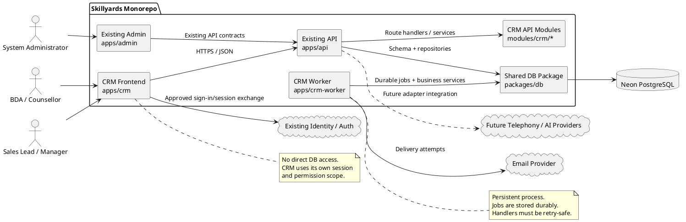

# SPEC-1 — Architecture and Repository Plan

**Status:** Architecture baseline confirmed; implementation paths and integration points must be verified against the current repository before coding.  
**Product:** Skillyards Sales CRM  
**Frontend URL:** `https://crm.skillyards.in`  
**API base:** Existing `apps/api` deployment, with CRM endpoints under `/api/crm`  
**Database:** Existing Neon PostgreSQL via `packages/db`  
**Worker:** Dedicated persistent process in the monorepo, initially targeting Railway

## 1. Architecture goals

The architecture must deliver a CRM that can be implemented incrementally without replacing existing Skillyards applications or duplicating authoritative business workflows.

Primary goals:

1. Provide a dedicated CRM user experience and deployment.
2. Reuse the existing API, identity system, database package, and authoritative student/admissions/payment workflows.
3. Keep database access out of the browser and centralize authorization in the API.
4. Support durable asynchronous operations such as notifications, escalation, and conversion reconciliation.
5. Preserve compatibility during coordinated frontend, API, database, and worker releases.
6. Make failure handling, operational ownership, and security boundaries explicit.

## 2. Logical architecture



### 2.1 Request path

For a normal CRM API request:

1. The browser sends an HTTPS request to the existing API.
2. The API validates the CRM session, including audience, expiry, and revocation state.
3. Authorization checks the requested action and resource scope.
4. The handler validates input and invokes a CRM service.
5. The service performs the required database operation, using a transaction for multi-record invariants.
6. Sensitive changes write audit events in the same transaction where practical.
7. If asynchronous work is required, the transaction writes a durable outbox/job record.
8. The API returns a documented success or error response.

**Invariant:** UI visibility is not an authorization boundary. Every protected operation must be authorized server-side.

## 3. Component responsibilities

### 3.1 CRM frontend — `apps/crm`

Responsibilities:
- CRM sign-in/session UX using the approved identity flow.
- Lead and enquiry search, lists, detail, and history.
- Duplicate review queues and resolution.
- Assignment, team, and transfer workflows according to permissions.
- Call logging and follow-up queue.
- Counselling scheduling and rescheduling.
- EOD submission and authorized correction workflows.
- Conversion status, notifications, and CRM-specific settings.
- Accessible form validation, loading states, empty states, and recoverable errors.

Constraints:
- No database credentials or direct PostgreSQL access.
- Do not treat client-side role checks as security enforcement.
- Do not calculate authoritative EOD targets or conversion eligibility solely in the browser.
- Do not keep long-lived credentials in browser storage when secure cookie-based sessions are available.
- Use a centralized API client for consistent error handling, request IDs, and session-expiry behavior.

### 3.2 Existing API — `apps/api`

Responsibilities:
- CRM session establishment/validation integration.
- API input validation and response/error contracts.
- Authorization and query scoping.
- CRM business services and transaction boundaries.
- Rate limiting and request correlation.
- Audit event creation.
- Outbox/job creation.
- Integration with existing student, admissions, counselling, EOD, and notification workflows.

Constraints:
- Follow existing repository conventions where compatible.
- Keep route handlers thin; place reusable business rules in service modules.
- Do not trust user IDs, roles, team scope, or permission claims supplied by the client.
- Use transactions for invariants that span multiple records.
- Avoid holding database transactions open while calling external providers.

### 3.3 Shared database package — `packages/db`

Responsibilities:
- Drizzle schema definitions and relations.
- Versioned migrations.
- Shared database connection/configuration conventions.
- Typed queries or repositories where this matches existing patterns.
- Indexes, unique constraints, foreign keys, and migration-safe defaults.

Constraints:
- Inspect the live schema and migration history before authoring migrations.
- Use `users.id` for new CRM ownership/actor references.
- Do not drop `employees` in the initial CRM migration.
- Avoid global unique constraints on lead phone/email.
- Keep migration changes additive until all old consumers have been migrated.
- Treat database constraints as the final guard for uniqueness and integrity, not application checks alone.

### 3.4 CRM worker — `apps/crm-worker`

Responsibilities:
- Transactional outbox processing and notification delivery.
- Follow-up escalation.
- Assignment recovery and stale-operation reconciliation.
- Conversion reconciliation.
- EOD summaries or scheduled work approved for automation.
- Retention/archive processing after policy approval.
- Job retry, lease recovery, dead-letter handling, and operational metrics.

Constraints:
- The worker is a separate process, not a second public API.
- Share validated business logic and database access through workspace packages where practical.
- Use durable database state for critical work; in-memory queues alone are insufficient.
- Every job must define idempotency behavior, retryability, maximum attempts, and terminal-failure handling.
- A worker must not bypass business rules merely because it does not originate from a human API request; use explicit service identities and narrowly scoped operations.

### 3.5 Existing admin — `apps/admin`

Responsibilities:
- Continue system-wide administration and provider/infrastructure configuration.
- Continue existing administrative workflows.
- Expose CRM administration only where deliberately assigned to the existing admin product.

CRM-specific configuration—sales teams, assignment rules, duplicate thresholds, target formulas, escalation policy, and sales notification preferences—belongs in the CRM unless a confirmed product decision places it elsewhere.

## 4. Proposed repository structure

The following is a target structure, not a claim that these paths already exist. Follow established conventions in the live repository when they differ.

```text
apps/
  crm/
    src/
      app/
      components/
      features/
        auth/
        leads/
        enquiries/
        duplicate-review/
        assignments/
        teams/
        calls/
        follow-ups/
        counselling/
        eod/
        admissions/
        notifications/
        settings/
      lib/
        api-client/
        auth/
        permissions/
        validation/
    tests/
  api/
    src/
      modules/
        crm/
          sessions/
          leads/
          enquiries/
          duplicate-review/
          assignments/
          teams/
          access/
          calls/
          follow-ups/
          counselling/
          eod/
          conversions/
          notifications/
          audit/
          settings/
    tests/
  crm-worker/
    src/
      jobs/
      processors/
      scheduler/
      observability/
      main.ts
    tests/
packages/
  db/
    src/
      schema/
        crm/
      migrations/
  # Add a shared CRM contracts/service package only if duplication
  # between frontend, API, and worker justifies it.
```

### 4.1 Module boundaries

- **Frontend feature modules** own screens and client-side interaction, not authorization or business truth.
- **API route modules** own HTTP mapping, validation, status codes, and authentication integration.
- **CRM services** own lifecycle transitions, assignment eligibility, duplicate decisions, conversion orchestration, and other business rules.
- **Repositories/queries** own data access and permission-scoped query construction.
- **Database schema/migrations** own persistent constraints and indexes.
- **Worker processors** orchestrate durable background work by calling reusable services or narrowly scoped service functions.
- **Provider adapters** isolate email and future telephony/AI/SMS provider-specific behavior.

Avoid circular dependencies. A worker processor should not import frontend code or depend on HTTP route handlers to execute business logic.

## 5. Data and transaction boundaries

### 5.1 PostgreSQL as the system of record

Neon PostgreSQL is the system of record for CRM leads, enquiry associations, assignment history, review cases, calls/follow-ups, counselling links, conversion state, audit events, and durable job/outbox records.

The frontend may cache data for UX, but cached state is never authoritative for permissions, capacity, lifecycle transitions, or conversion eligibility.

### 5.2 Transactions

Use a single database transaction for related changes when all required records are in the same database. Examples:

- Associate an enquiry and record the corresponding audit event.
- Assign a lead, write assignment history, and enqueue notification events.
- Create a call log and callback task with its idempotency record.
- Reschedule a counselling session and append its history.
- Submit or amend an EOD report and persist its revision.
- Create conversion state and student records only if the existing workflow can safely participate in the same transaction.

If a workflow crosses a transaction boundary or external system, use a durable outbox/state machine and reconciliation. Never hold a database transaction open while waiting on an email, telephony, or AI provider.

### 5.3 Concurrency controls

Use database constraints and explicit concurrency controls for business invariants:

- Idempotency: unique key in a documented operation scope.
- Round-robin: lock/update the corresponding assignment cursor transactionally.
- Capacity: atomically reserve capacity or lock the relevant capacity/workload rows; the precise workload definition must be approved.
- Duplicate review: conditional state transition or row lock to prevent conflicting resolutions.
- Conversion: unique operation key and transactional/state-machine protection against concurrent creation.
- EOD correction: revision/optimistic version check to reject stale updates.

Application-level “check then insert” without a database-enforced invariant is not sufficient for concurrent workflows.

## 6. Identity and security boundaries

- Reuse the existing identity system; do not create a separate user directory.
- Establish a CRM-specific session with an explicit audience and server-side revocation state.
- Validate session, expiry, revocation, action permission, resource scope, and any approval requirement for every protected request.
- Use secure cookies with minimum necessary domain scope; implement CSRF protection appropriate to the cookie/session design.
- Configure CORS for the CRM production origin and approved local origins.
- Never accept frontend-supplied role/team claims as authoritative.
- Apply permission filters in database queries for list/search/export endpoints.
- Keep provider secrets in server-side environment/secret management, never in browser bundles or API responses.
- Log correlation IDs and security-relevant outcomes without logging tokens, passwords, or unnecessary personal information.
- Define fail-closed behavior when session revocation or authorization dependencies cannot be checked.

Detailed role and permission semantics are specified in `04-auth-and-authorization.md`; implementation must keep the documents aligned.

## 7. Durable asynchronous processing

### 7.1 Outbox pattern

When a business transaction needs asynchronous work, write the business change and an outbox record in the same transaction. A worker claims pending records using a lease or equivalent concurrency-safe mechanism, performs the action, and records delivery/processing status.

### 7.2 Job lifecycle

Recommended conceptual states:

- `pending`: ready to be claimed.
- `processing`: claimed with a lease.
- `retry_wait`: failed transiently and scheduled for retry.
- `completed`: finished successfully.
- `dead_letter`: attempts exhausted or a permanent failure requires operator action.
- `cancelled`: explicitly cancelled under an authorized policy.

The final schema may use a smaller set if it can represent the same operational guarantees.

### 7.3 Retry rules

- Use bounded exponential backoff with jitter for retryable failures.
- Do not retry permanent validation or authorization failures indefinitely.
- Make handlers idempotent or store provider/idempotency references before retrying side effects.
- Recover expired leases after worker crashes.
- Record attempt count, next attempt time, last error category, and timestamps.
- Provide an operational path to inspect and safely retry/reconcile dead-letter jobs.

Existing QStash may be used for appropriate delayed triggers, but critical work must remain recoverable from durable database state.

## 8. Deployment and environment configuration

### 8.1 Deployable units

| Unit | Responsibility | Initial hosting direction |
|---|---|---|
| `apps/crm` | CRM web application | Vercel, consistent with existing frontends |
| `apps/api` | Existing shared API plus CRM endpoints | Existing API deployment |
| `packages/db` | Shared schema/migrations, not a runtime service | Monorepo package |
| `apps/crm-worker` | Durable asynchronous processing | Railway persistent worker |
| Neon PostgreSQL | System-of-record database | Existing Neon project |

Hosting is a proposed deployment direction and must be confirmed against the actual project configuration and operational constraints.

### 8.2 Environment variables

Use the repository's established variable names where possible. At minimum, document the configuration categories below without committing secret values:

- Database connection/configuration.
- CRM public origin and API base URL.
- Allowed CORS origins.
- Session signing/verification configuration and revocation storage.
- Email provider credentials and sender identity.
- Worker concurrency, polling/claim interval, lease duration, and retry limits.
- Observability endpoint/configuration.
- Feature flags for staged rollout.

Validation rules:
- Fail startup when required configuration is missing or malformed.
- Do not log secret values.
- Keep development, staging, and production credentials separate.
- Avoid duplicating secrets across frontend and server environments unnecessarily.

### 8.3 Domains and CORS

- CRM: `crm.skillyards.in`.
- Existing admin: `admin.skillyards.in`.
- Existing API: `api.skillyards.in`.
- Local development origin: confirm the actual CRM development port before allow-listing it.
- Use HTTPS in production.
- Permit only explicit origins and required methods/headers; do not combine credentialed requests with wildcard origins.

## 9. Release and migration strategy

Use an expand–migrate–contract approach.

1. **Inventory:** verify current schema, constraints, migration history, route conventions, environment variables, and consumers of existing tables.
2. **Expand:** add new tables/indexes and nullable columns; avoid destructive renames/drops.
3. **Compatible backend:** deploy code that can operate with old and new data shapes during transition.
4. **Backfill:** populate canonical leads and enquiry associations conservatively; send ambiguous matches to review.
5. **Validate:** reconcile row counts, foreign keys, nullability, duplicate-review cases, and business metrics.
6. **Enable gradually:** use a feature flag or controlled rollout for CRM intake and workflows.
7. **Observe:** monitor errors, queue backlog, assignment outcomes, conversion failures, and legacy workflow regressions.
8. **Contract later:** remove obsolete paths only after all consumers have migrated and recovery has been validated.

Do not treat a database rollback as automatically safe after data has been written in the new format. For each release, document whether recovery requires rollback, forward-fix, or restore/reconciliation.

## 10. Failure handling and operational ownership

| Failure | Required behavior |
|---|---|
| CRM API unavailable | UI displays a recoverable error; no false success state |
| Session/revocation check unavailable | Protected CRM request fails closed |
| Database transaction fails | No partial business operation; retry only when safe |
| Assignment has no eligible representative | Apply configured fallback and expose reason/status |
| Notification provider unavailable | Keep durable outbox item and retry within policy |
| Worker crashes | Recover expired leases and retry safe jobs |
| Conversion partially completes | Mark/reconcile durable conversion state; do not create duplicate student/payment |
| Duplicate review conflict | Reject stale/conflicting resolution and return current case state |
| Migration/backfill mismatch | Stop workflow enablement and investigate reconciliation output |
| Invalid configuration | Reject change; retain last known valid configuration |

Define an operational owner for alerts, dead-letter review, reconciliation, backup/restore, and production incident response before general rollout.

## 11. Testing boundaries

Testing must cover the interfaces between components, not only isolated modules.

- **Frontend:** form validation, session expiry, permission-aware UX, loading/error/empty states, keyboard accessibility.
- **API:** request validation, status/error contracts, authorization, rate limiting, audit creation.
- **Database:** migrations, constraints, indexes, transactions, rollback/forward recovery.
- **Worker:** lease expiry, retry, dead-letter, duplicate delivery, restart recovery.
- **Integrations:** email provider failure, admissions event replay, existing student workflow.
- **End-to-end:** enquiry → lead → assignment → call/follow-up → counselling → conversion → authoritative enrolment.
- **Regression:** existing website, admin, student, payment, counselling, and EOD workflows.
- **Load/security:** concurrent assignment, concurrent conversion, permission leakage, session revocation, and API performance.

## 12. Implementation sequence

1. Validate repository state and record actual schema/API contracts.
2. Resolve migration sequencing and establish automated test/CI baseline.
3. Implement CRM session, authorization primitives, audit foundation, and feature flags.
4. Add leads, enquiry association, intake idempotency, duplicate review, and assignment.
5. Add calls, follow-ups, counselling, EOD, and notification outbox.
6. Add conversion orchestration, admissions milestone integration, and reconciliation.
7. Add retention controls and operational runbooks.
8. Add optional telephony/AI/provider adapters after the core workflows are stable.
9. Run acceptance, regression, concurrency, security, and performance tests before phased production enablement.

Detailed requirements and exit criteria are in `01-background-requirements.md` and `09-implementation-and-acceptance.md`. Keep those documents synchronized if architecture decisions change.

## 13. Architecture decisions requiring confirmation

| ID | Decision | Starting assumption |
|---|---|---|
| ARCH-001 | Hosting and environment strategy | Vercel for frontend/API where already established; Railway for persistent worker; verify actual project setup |
| ARCH-002 | CRM local development port | Use repository convention after inspection; do not assume a port in CORS configuration |
| ARCH-003 | Shared contracts package | Add only if frontend/API/worker duplication justifies it; avoid premature abstraction |
| ARCH-004 | Worker claim model | PostgreSQL-backed durable job/outbox records with leases and bounded retries |
| ARCH-005 | Capacity accounting | Define workload/status set before implementing atomic reservation |
| ARCH-006 | Rollout controls | Feature flag or controlled enablement after backfill reconciliation |
| ARCH-007 | Session revocation availability | Fail closed for protected CRM requests if revocation state cannot be checked |

## 14. Architecture acceptance checklist

The architecture is ready to proceed to implementation planning when:

- [ ] Current repository paths and deployment configuration have been verified.
- [ ] CRM frontend has no direct database access.
- [ ] API is the enforcement point for authentication, authorization, validation, and business invariants.
- [ ] Transaction boundaries and concurrency controls are documented for assignment, duplicate resolution, callbacks, EOD amendments, and conversion.
- [ ] Critical background work is durable and retry-safe.
- [ ] Schema changes follow expand–migrate–contract and include reconciliation/recovery instructions.
- [ ] Existing applications and workflows have a regression test baseline.
- [ ] Operational failure modes have owners and runbooks.
- [ ] Open decisions affecting production behavior have named decision owners.

## 15. Need Professional Help in Developing Your Architecture?

Please contact me at [sammuti.com](https://sammuti.com) :)
