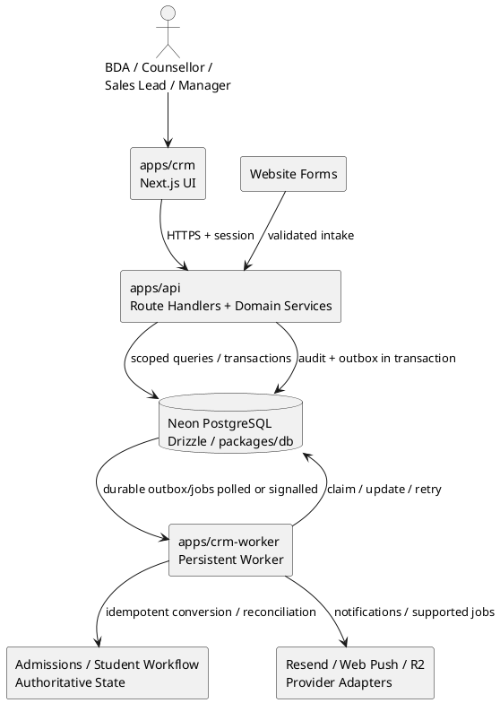

# Skillyards Sales CRM — Detailed Architecture Specification

**Document set:** 10 files  
**Status:** In Active Development (Phases 1, 2 & 3 Completed — Sales Operations, Counselling & EOD Live)  
**Repository:** `/home/chakresh/Skillyards`  
**Primary applications:** `apps/crm`, `apps/api`, `apps/crm-worker`, `packages/db`  
**Frontend domain:** `crm.skillyards.in` (Local: `http://localhost:3003`)  
**Database:** Existing Neon PostgreSQL database via Drizzle  
**Last updated:** 2026-10-16

---

## 0. Current Implementation Status (Updated 2026-10-16)

### Phase 1 Foundation & Full-Stack Architecture Setup: Completed

#### 1. Data Model & Live Database (`packages/db`)
- **Live Migration Applied:** `0027_magenta_paper_doll.sql` executed against Neon PostgreSQL via `run-migration-0027.js`.
- **`leads` Table:** Canonical entity created/reconciled with indexes on `(assigned_to_user_id, status, updated_at)`, `(assigned_team_id, status, updated_at)`, `normalized_phone`, `normalized_email`, `created_at`, `status`.
- **`sales_teams` & `sales_team_memberships`:** Team hierarchy and auditably dated memberships.
- **`crm_user_roles`:** Granular CRM role grants (`bda`, `counsellor`, `sales_lead`, `sales_manager`, `crm_admin`) distinct from platform roles.
- **`crm_audit_events`:** Append-only change history logging actor, action, snapshots, and request ID.
- **`crm_idempotency_keys`:** Replay cache for intake requests.
- **`lead_duplicate_reviews` & `lead_merge_history`:** Tables for duplicate candidate reviews and auditable non-destructive merges.
- **`enquiries` Migration:** Backward-compatible columns added: `lead_id` FK, `normalized_phone`, `normalized_email`, `processingStatus`, `processed_at`.

#### 2. Backend Architecture (`apps/api`)
- **CORS Configuration (`utils/cors.js`):** Added `https://crm.skillyards.in` and `http://localhost:3003` to allowed origins; exposed `Idempotency-Key` and `x-request-id` headers.
- **Contact Normalization (`utils/normalization.js`):** Phone normalized to E.164 (`+91...`), email trimmed and lowercased.
- **CRM Authorization & Scoping (`modules/crm/crm.permissions.js`):** Implemented `canAccessCrm` and record-level `canAccessLead` guards evaluating platform roles and active `crm_user_roles`.
- **Domain Service & Repository (`modules/crm/`):**
  - `crm.lead.repository.js`: Scoped querying, join with assigned users/teams, insert/update operations, audit logging.
  - `crm.lead.service.js`: Input normalization, lifecycle state validation, audit trails.
- **REST Route Handlers (`app/api/crm/`):**
  - `GET /api/crm/me`: Session identity, active CRM roles, permissions.
  - `GET /api/crm/leads`: Paginated, filtered (`status`, `search`) lead list.
  - `POST /api/crm/leads`: Validated lead creation with audit logging.
  - `GET /api/crm/leads/[id]`: Individual lead detail.
  - `PATCH /api/crm/leads/[id]`: Status and rep assignment updates.

#### 3. Frontend Architecture (`apps/crm` — Port 3003)
- **Monorepo Next.js App (`apps/crm`):** Configured with Next.js 16, Tailwind CSS v4, and API proxy rewrites (`/api/*` → API server).
- **Design System (`globals.css`):** Sleek dark CRM palette, glass panels, customized scrollbars, interactive status badges.
- **Auth Provider (`context/AuthContext.jsx`):** Seamless cookie-based session hydration and CRM role state.
- **Views Implemented:**
  - `Dashboard (/)`: Real-time KPI summary cards and Recent Prospects table.
  - `Leads Directory (/leads)`: Pipeline view with status filter tabs, search bar, and responsive table.
  - `NewLeadModal`: Modal form for staff lead creation.

---

### Phase 2 Intake, Deduplication, Rep Workspace & Assignment: Completed (Updated 2026-10-16)

#### 1. Lead Workspace & Timeline (`apps/crm/src/app/(dashboard)/leads/[id]`):
- **Full Lead Profile:** Normalized phone & email with click-to-call (`tel:`) and click-to-email (`mailto:`), copy details action.
- **Fast Call Logger:** In-page form for BDAs with outcome presets (`reached`, `callback_requested`, `not_reached`, `busy`, etc.), duration presets, notes, and callback schedule.
- **Unified Activity Timeline:** Chronological feed merging call logs, status changes, assignments, and website form submissions.
- **Lifecycle & Ownership Management:** Interactive stage selector and sales rep transfer dropdown.
- **Linked Enquiries:** Tab displaying all historical website form submissions.

#### 2. Intake & Deduplication Engine (`apps/api/src/modules/crm/`):
- **Deterministic 4-Scenario Matching (`crm.intake.service.js`):**
  - Exact match (Phone + Email): Auto-associates to existing canonical lead and touches timestamps.
  - Zero match: Automatically creates a canonical lead (`status: 'new'`) and routes via round-robin.
  - High-risk split collision: Flags `lead_duplicate_reviews` with `high` risk and leaves enquiry for review.
  - Single-field match: Flags `lead_duplicate_reviews` with `medium` risk and links with `processingStatus: 'needs_review'`.
- **Live Website Integration:** Bridged `/api/enquiries` into `ingestEnquiryService` while preserving CAPTCHA and emails.
- **Manager Duplicate Reviews (`/duplicates`):** Screen comparing candidate lead vs incoming submission side-by-side with one-click resolution.

#### 3. Capacity-Aware Round-Robin Assignment Engine (`crm.assignment.service.js`):
- **Workload & Capacity Limits:** Enforces active lead cap (`DEFAULT_REP_CAPACITY = 50`) excluding converted/lost/cold leads.
- **Deterministic Routing:** Workload-aware sorting with least-recently-assigned tie-breaking.
- **Unassigned Fallback Queue:** Safely routes leads to `unassigned` pool if reps are at full capacity without losing leads.
- **Queue Screen (`/queue`):** Reps can inspect unassigned pool, claim leads with a single click, or view their personal active call queue.

---

### Phase 3 Sales Operations, Counselling & EOD Attainment: Completed (Updated 2026-10-16)

#### 1. Single Source of Truth Design System & Contrast Compliance (`apps/crm/src/app/globals.css`, `status.js`)
- **Centralized 5-Family Palette:** Configured `@theme` tokens for `dark-teal`, `deep-ocean`, `pale-oak`, `dark-wine`, and `platinum` (50–950) with strict WCAG AA/AAA contrast.
- **Global Component CSS Classes:** Standardized `.crm-panel`, `.crm-card`, `.crm-btn-primary`, `.crm-btn-secondary`, `.crm-btn-danger`, `.crm-btn-ghost`, `.crm-input`, `.crm-select`, `.crm-textarea`, `.crm-label`, `.crm-tab-bar`, `.crm-table`, and `.crm-badge-*` classes across the entire web application.
- **Centralized Status Mapper (`lib/status.js`):** Single source of truth for pipeline stages, follow-up states, counselling outcomes, and enquiry sources.
- **Complete Application Consistency:** Refactored Dashboard, Leads, Lead Workspace, Duplicate Reviews, Queue, Follow-ups, Counselling, and EOD screens to eliminate arbitrary ad-hoc inline styles and color mismatches.

#### 2. Track 1: Follow-ups & Callback Queue (`apps/crm/src/app/(dashboard)/follow-ups`)
- **Priority Urgency Buckets:** Chronological separation of `Overdue`, `Due Today`, `Upcoming`, and `Completed` follow-up tasks with urgency sorting.
- **Fast Task Resolution:** Quick mark-as-complete modal with resolution notes, and reschedule modal capturing callback date/time and reason.
- **Audit & Timeline Integration:** Follow-up completion and reschedule events write structured audit records into `crm_audit_events` and appear directly on the lead timeline.
- **Backend Architecture (`apps/api/src/modules/crm/`):**
  - `crm.followup.repository.js`: Scoped extraction of tasks with callback schedules, joining telecallers, and normalized lead contact profiles.
  - `crm.followup.service.js`: Domain validation, urgency bucket sorting, and audit event dispatch.
  - REST endpoints: `GET /api/crm/follow-ups` & `PATCH /api/crm/follow-ups/[id]`.

#### 3. Track 2: Counselling Session Management (`apps/crm/src/app/(dashboard)/counselling`)
- **Canonical Lead Linkage:** Auto-associates sessions with canonical `leads` via phone matching and lead ID referencing.
- **Session Lifecycle & History Preservation:** Full scheduling, conducting, and logging workflow for walk-in, phone, and referral sessions. Rescheduling updates scheduled date on the exact same session identity while preserving previous date, new date, actor, timestamp, and reason in append-only `crmAuditEvents`.
- **Controlled Session Outcomes:** Full support for `session_booked`, `completed`, `enrolled`, `follow_up`, `not_interested`, `no_response`, `no_show`, and `cancelled`.
- **Lead State Synchronization:** Booking counselling auto-advances lead status to `counselling_scheduled`; marking session completed transitions lead to `counselled`; enrolling transitions lead to `converted`.
- **Lead Detail Integration (`/leads/[id]`):** Dedicated "Book Counselling" quick action, linked sessions tab, and timeline entries.
- **Backend Architecture (`apps/api/src/modules/crm/`):**
  - `crm.counselling.repository.js`: Scoped session queries with filtering (`outcome`, `source`, `counselorId`, date range, search) and aggregate KPI metrics.
  - `crm.counselling.service.js`: Domain booking logic, reschedule history logging, and outcome transitions.
  - REST endpoints: `GET /api/crm/counselling`, `POST /api/crm/counselling`, `GET /api/crm/counselling/[id]`, `POST /api/crm/counselling/[id]/reschedule`, `POST /api/crm/counselling/[id]/status`, `DELETE /api/crm/counselling/[id]`, and `POST /api/crm/leads/[id]/counselling`.

#### 4. Track 3: Server-Authoritative EOD Attainment Engine (`apps/crm/src/app/(dashboard)/eod`)
- **Server-Owned Target Engine (SPEC-6 & SPEC-8):**
  - Pure domain function `calculateEodTargets(completedCounsellingCount, config)` enforcing locked formulas:
    - $\text{dialTarget} = \max(0, 120 - \text{completedCounselling} \times 15)$
    - $\text{connectTarget} = \max(30, 50 - \text{completedCounselling} \times 5)$
    - $\text{talkTimeTargetMinutes} = 90 \text{ mins}$
  - Config versioning (`v1.0`) snapshot stored with each report.
- **Server-Authoritative Counselling Attribution:** Server queries verified completed/enrolled sessions for reporting rep and date; client cannot forge or submit arbitrary counselling numbers.
- **Auto-Aggregated CRM Call Actuals:** Automatically extracts live dials, connects (`reached`, `callback_requested`, `interested`), and talk-time duration from `follow_ups` call logs.
- **Submission Validation & Conflict Protection:** Enforces business submission cutoff (7:30 PM IST), Sunday policy, and prevents accidental re-submissions (`409 Conflict: EOD_REPORT_ALREADY_SUBMITTED`).
- **Audited Manager Amendment:** Privileged managers/admins can adjust actuals with mandatory `amendmentReason` (`EOD_AMENDMENT_REASON_REQUIRED`), incrementing revision (`v{N+1}`) while archiving previous snapshots in the immutable revision ledger.
- **Frontend EOD Workspace (`/eod`):** Live attainment gauges (Dials, Connects, Talk Time, Overall Target Met), target relief calculator breakdown, unsubmitted form with auto-counts, submitted locked state, manager amendment modal, and revision history drawer.
- **Backend Architecture (`apps/api/src/modules/crm/`):**
  - `crm.eod.service.js`: Target calculation, attainment scoring, report validation, and revision handling.
  - REST endpoints: `GET /api/crm/eod/preview`, `POST /api/crm/eod-reports`, `GET /api/crm/eod-reports`, `GET /api/crm/eod-reports/[id]`, and `POST /api/crm/eod-reports/[id]/amend`.

---

## 1. Purpose of this document set

This README is the entry point for the detailed Skillyards Sales CRM design. It explains how the individual specifications fit together, the proposed architecture, implementation order, key constraints, and the decisions that must be settled before production rollout.

The specifications are implementation-oriented proposals based on the repository context reviewed during design. They distinguish existing-system observations from proposed target behavior. Before coding, the team must verify current repository files, dependency versions, database schema, API conventions, and deployment configuration.

## 2. Specification index

Read the documents in this order:

1. [`01-background-requirements-detailed.md`](./01-background-requirements-detailed.md) — Background, scope, MoSCoW requirements, acceptance scenarios, success measures, and open decisions.
2. [`02-architecture-detailed.md`](./02-architecture-detailed.md) — Application boundaries, architecture diagram, deployment, transaction strategy, failure handling, and rollout.
3. [`03-data-model-detailed.md`](./03-data-model-detailed.md) — Proposed database entities, relationships, constraints, indexes, migration approach, and data integrity.
4. [`04-auth-and-authorization-detailed.md`](./04-auth-and-authorization-detailed.md) — Sessions, roles, permissions, data scoping, team access, security, and authorization tests.
5. [`05-intake-duplicates-assignment-detailed.md`](./05-intake-duplicates-assignment-detailed.md) — Enquiry intake, contact normalization, idempotency, duplicate review, merge policy, and capacity-safe assignment.
6. [`06-sales-operations-detailed.md`](./06-sales-operations-detailed.md) — Call logging, follow-up tasks, counselling sessions, EOD targets/reports, and migration compatibility.
7. [`07-conversion-notifications-workers-detailed.md`](./07-conversion-notifications-workers-detailed.md) — Admission conversion, authoritative enrolment milestones, notifications, transactional outbox, background jobs, retries, and operations.
8. [`08-api-contracts-detailed.md`](./08-api-contracts-detailed.md) — Proposed REST contracts, request/response envelopes, error codes, pagination, idempotency, and API tests.
9. [`09-implementation-and-acceptance-detailed.md`](./09-implementation-and-acceptance-detailed.md) — Phased delivery, milestones, exit gates, tests, rollout, risk register, and sign-off.
10. [`TELECALLING_DIALER_ARCHITECTURE_GUIDE.md`](./TELECALLING_DIALER_ARCHITECTURE_GUIDE.md) — Telecalling softphone dialer architecture, WebRTC vs GSM comparison, state machine, audio synthesizer, and EOD attribution integration.

This README is the index and governance layer for the document set.

## 3. Current-system context

The design takes the following repository observations as the starting point. Verify them against the current branch before implementation:

- The repository is an npm workspace containing applications under `apps/*` and shared packages under `packages/*`.
- Existing applications include `apps/api`, `apps/admin`, `apps/website`, `apps/pdf-service`, `apps/ai-service`, and `apps/cms`.
- The frontends use Next.js; API functionality is implemented with Next.js Route Handlers.
- Shared database code is in `packages/db`, using Drizzle and Neon PostgreSQL.
- The PDF worker is deployed on Railway; the AI service uses Express and currently has an in-memory audio queue.
- GitHub Actions runs end-of-day scheduled work; QStash is used for delayed jobs.
- Existing integrations include Resend email, web push, and Cloudflare R2.
- Existing tables include `enquiries`, `follow_ups`, `call_analyses`, `counselling_sessions`, `eod_reports`, `eod_warnings`, `students`, `payments`, `plans`, `installments`, `batches`, `users`, and legacy `employees`.
- Website `enquiries` are submissions, not the canonical CRM lead entity.
- Existing authentication uses JWT HS256 via `jose`, a `session` cookie, `.skillyards.in` cookie domain, and a seven-day expiry. The existing design is stateless and does not provide immediate centralized revocation.
- Existing platform roles include `ADMIN`, `MANAGER`, `SALES`, `HR`, `DEVELOPER`, `DIGITAL_MARKETER`, `EDITOR`, `OUTSIDE_SALES`, and `STUDENT`. CRM-specific roles are proposed separately.
- `employees` is a legacy/orphaned table still referenced by a hardcoded ID mapping in the telephony GSM callback.
- `follow_ups` is utilized for call logging and augmented with callback task analysis in `crm.followup.service.js`.
- `counselling_sessions` is linked to canonical CRM leads through normalized phone matching, lead timeline integration, and dedicated CRM routes.
- EOD formulas have been transitioned from frontend to server-authoritative domain services (`crm.eod.service.js`) with locked target snapshots, automated counselling relief, and audited manager amendments.
- `eod_reports` has a unique `(user_id, date)` key and stores the authoritative target snapshot, actuals, attainments, and revision ledger.
- `students` does not currently expose the complete admission milestone model required by the CRM.
- CORS configuration needs review for `crm.skillyards.in` and the agreed local CRM development origin.
- Migration sequence collisions, manual scripts, and limited automated test coverage are known implementation risks.

These are repository-context observations, not a substitute for a fresh inventory at implementation time.

## 4. Target architecture summary

### 4.1 Components

| Component | Responsibility |
|---|---|
| `apps/crm` | Role-specific CRM interface for lead intake, queues, assignment, calls, follow-ups, counselling, EOD, conversion status, and notifications |
| `apps/api` | Authentication/authorization, validation, domain use cases, transaction boundaries, REST contracts, and integration endpoints |
| `packages/db` | Drizzle schema, migrations, repositories, typed domain services, constraints, and transaction helpers where appropriate |
| `apps/crm-worker` | Persistent background processing for outbox delivery, notifications, reminders, reconciliation, retention, and durable AI jobs |
| Existing admissions/student workflow | Authoritative creation/linking of students/admissions and source of truth for full-enrolment state |
| Neon PostgreSQL | Canonical operational data, assignment/capacity state, audit history, idempotency, outbox, and jobs |
| Existing integrations | Resend email, web push, Cloudflare R2, QStash where appropriate, and other existing services through adapters |

### 4.2 Architecture diagram

### 4.3 Architectural rules

- The browser never connects directly to PostgreSQL.
- API route handlers remain thin and call domain use cases.
- Authorization is checked server-side on every request and scoped query.
- Audit and outbox intent are written with the corresponding business transaction.
- External provider calls occur outside core database transactions.
- Critical jobs are persisted durably; an in-memory queue is not the source of truth.
- Admission creation and full enrolment are driven by the authoritative admissions workflow.
- Existing website, telephony, student, payment, and admin flows remain compatible during staged migration.

## 5. Key domain decisions

### 5.1 Leads and enquiries

- `leads` is the canonical CRM prospect entity.
- `enquiries` remains an inbound submission record.
- One lead may have multiple enquiries; each enquiry is associated with at most one canonical lead at a time.
- Raw phone/email values are preserved; normalized values support exact matching.
- Repeated request retries are handled through idempotency keys, separately from duplicate-person detection.
- Exact normalized phone plus email may auto-associate only when no conflicting evidence exists.
- Phone-only, email-only, and conflicting matches require review.
- High-risk unresolved duplicate cases block conversion.
- Merge operations preserve source/history and do not physically delete the losing lead.

### 5.2 Assignment and teams

- CRM roles are separate from platform roles; a user may hold multiple CRM roles.
- Effective permissions are the union of assigned permissions, constrained by record scope and explicit policy.
- Team membership is effective-dated; historical membership is retained.
- Proposed constraint: one active sales-team membership per user unless product owners approve multi-team membership.
- Assignment strategies include manual, round-robin, workload-aware, and least-recently-assigned.
- Lower numeric rule priority is evaluated first; the first matching valid rule is used.
- Capacity and round-robin state are protected transactionally in PostgreSQL.
- No-eligible-rep behavior uses an explicit fallback or unassigned queue; intake must not be silently lost.
- Existing ownership is retained by default when an owner becomes inactive; manager review/reassignment follows configured policy.
- Cross-team transfer requires appropriate manager permission/approval.

### 5.3 Sales operations

- Call records represent historical contact attempts; follow-up tasks represent future obligations.
- Callback follow-up creation requires both date and time and is atomic with call creation.
- Follow-up queues use overdue/due-today/upcoming ordering with configured timezone semantics.
- Counselling sessions are linked to canonical leads; reschedules preserve history on the same session ID.
- Only completed counselling sessions count toward EOD under the approved attribution rule.
- The API owns EOD formulas, target snapshots, and submission validation.
- Submitted reports are locked except through an audited manager amendment.

### 5.4 Conversion

- `admission_initiated` and `fully_enrolled` are distinct milestones.
- Student/admission creation and full-enrolment state are sourced from the authoritative workflow.
- Ambiguous existing-student matches require review.
- Conversion is idempotent and reconciled after uncertain cross-service failures.
- CRM conversion does not independently create payments, receipts, or installments.
- Out-of-order or duplicate events must not downgrade milestones or duplicate side effects.

### 5.5 Notifications and workers

- Domain transactions persist notification intent to an outbox.
- A persistent worker claims work with a lease or equivalent concurrency-safe mechanism.
- Retries use bounded exponential backoff with jitter and a dead-letter path.
- In-app and email notifications are MVP channels; additional channels are adapters subject to consent and compliance.
- Delayed jobs re-check current domain state before sending or changing anything.
- The database remains the source of truth if QStash is used to wake/schedule work.
- Job replay is authorized, auditable, and idempotent.

## 6. Security model summary

### Identity
- Reuse the existing user identity system.
- Introduce CRM-specific sessions/revocation support for centralized invalidation.
- Keep platform roles distinct from CRM roles.
- Never trust client-supplied actor IDs, roles, teams, owners, targets, or milestones.

### Authorization
- BDA: own leads unless explicitly granted additional scope.
- Counsellor: assigned counselling leads/sessions and permitted operational records.
- Sales lead: team-level leads and operational queues.
- Sales manager: cross-CRM access only with the required explicit permission.
- Temporary grants expand visibility but do not transfer ownership.
- Every list/detail/timeline/search endpoint applies scope at query time.

### Application and integration security
- Use secure cookie settings, CSRF protection, and explicit CORS origins.
- Validate public intake with rate limits and abuse controls.
- Protect internal endpoints with service authentication and replay protection.
- Keep recordings private and issue short-lived access URLs only after authorization.
- Use least-privilege worker credentials and keep provider secrets out of browser bundles and logs.
- Audit merges, transfers, privileged EOD amendments, rule edits, and operational replays.

## 7. Cross-document implementation order

1. **Discover:** inventory tables, routes, callbacks, auth, deployments, migration history, and consumers.
2. **Decide:** settle critical open questions—especially admissions truth, EOD policy, team/capacity rules, timezone, and retention.
3. **Foundation:** implement schema, CRM session revocation, roles/permissions, audit, and idempotency.
4. **Intake:** add canonical leads, enquiry association, normalization, duplicate review, and assignment.
5. **Operations:** implement calls, follow-ups, counselling, and server-owned EOD.
6. **Durability:** deploy outbox/worker, notifications, retries, and reconciliation.
7. **Conversion:** integrate with authoritative admissions state and idempotent conversion.
8. **Frontend:** finish role-specific operational screens against agreed API contracts.
9. **Validate:** run regression, concurrency, security, performance, migration, and recovery tests.
10. **Roll out:** enable gradually with feature flags, monitoring, and tested rollback/forward-fix plans.

See `09-implementation-and-acceptance-detailed.md` for phase-by-phase tasks and exit gates.

## 8. Non-functional targets

Initial targets, to be validated against a representative baseline workload:

- Ordinary API p95 latency: **≤ 500 ms**.
- Assignment p95 latency: **≤ 1 second**.
- Error rate under baseline load: **< 1%**.
- Assignment capacity invariant violations: **zero**.
- Duplicate student/admission side effects from conversion retries: **zero**.
- Unauthorized cross-scope reads/writes: **zero**.
- Critical jobs/outbox events lost on worker restart: **zero**.

The team must define data volume, request mix, concurrency, and measurement window before treating these as release gates.

## 9. Critical risks

| Risk | Required mitigation |
|---|---|
| Existing `follow_ups` mixes call and task semantics | Inventory consumers; migrate additively; regression-test telephony and reports |
| Legacy `employees` ID mapping in GSM callback | Preserve compatibility until a tested replacement is live |
| Stateless JWT lacks immediate revocation | Add CRM session registry/revocation and validate current session state |
| Migration sequence collisions/manual scripts | Standardize migration generation and validate clean/existing database upgrades |
| Assignment race conditions | PostgreSQL locks/reservations, unique constraints, concurrency tests, reconciliation |
| Ambiguous existing-student identity | Review workflow; never create/link solely from a weak match |
| Volatile AI queue | Durable job records and worker retries |
| Frontend-owned EOD formulas | Move calculation and validation to API; snapshot config/version |
| Missing full-enrolment source of truth | Resolve before conversion milestone rollout |
| Unapproved retention/deletion rules | Approve category-specific retention and legal holds before automated cleanup |
| Insufficient automated tests | Establish CI and critical regression paths in the foundation phase |

## 10. Decisions required before production

Assign an owner and deadline for each:

1. Which authoritative table/service/event defines `fully_enrolled`?
2. Can a person/lead have multiple admission records or programme enrolments?
3. Which fields are required before conversion, and what is the existing-student matching policy?
4. Confirm EOD formulas and counselling attribution.
5. Select organization/team timezone for business dates and reminders.
6. Define active lead statuses and default capacity per rep.
7. Decide whether duplicate-review intake creates a flagged provisional lead or leaves the enquiry unassociated.
8. Decide follow-up ownership behavior on lead transfer.
9. Confirm one active sales-team membership per user or approve multi-team membership.
10. Define data retention, recording retention, audit retention, and legal-hold behavior.
11. Confirm initial load profile and performance release gates.
12. Assign worker/on-call ownership and conversion reconciliation responsibility.
13. Confirm MVP exclusions: CSV import, telephony automation, WhatsApp/SMS, and advanced AI decisions.
14. Confirm API response conventions and service-to-service authentication.

## 11. Definition of done

The architecture is implementation-ready when:
- all ten detailed documents are reviewed as a set;
- open decisions have owners and documented resolutions;
- the current repository/schema/deployment inventory is refreshed;
- migrations and API contracts are approved;
- core role/scope, idempotency, concurrency, and audit guarantees are tested;
- authoritative admissions integration is defined;
- worker recovery and operational runbooks are verified;
- phased rollout and rollback plans are approved.

Production acceptance additionally requires the criteria in `09-implementation-and-acceptance-detailed.md` and the feature-specific acceptance checklists in Files 1–8.

## 12. Professional architecture and implementation help

For professional help developing this architecture, see [sammuti.com](https://sammuti.com).
