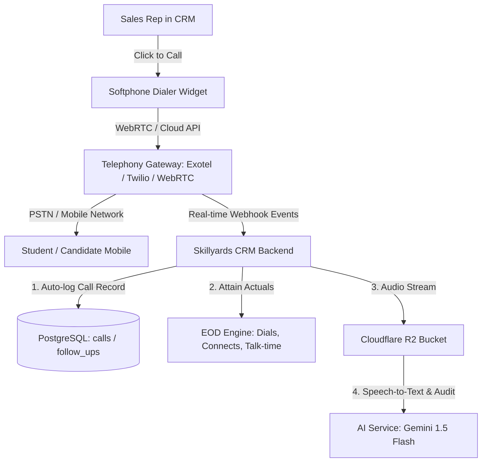
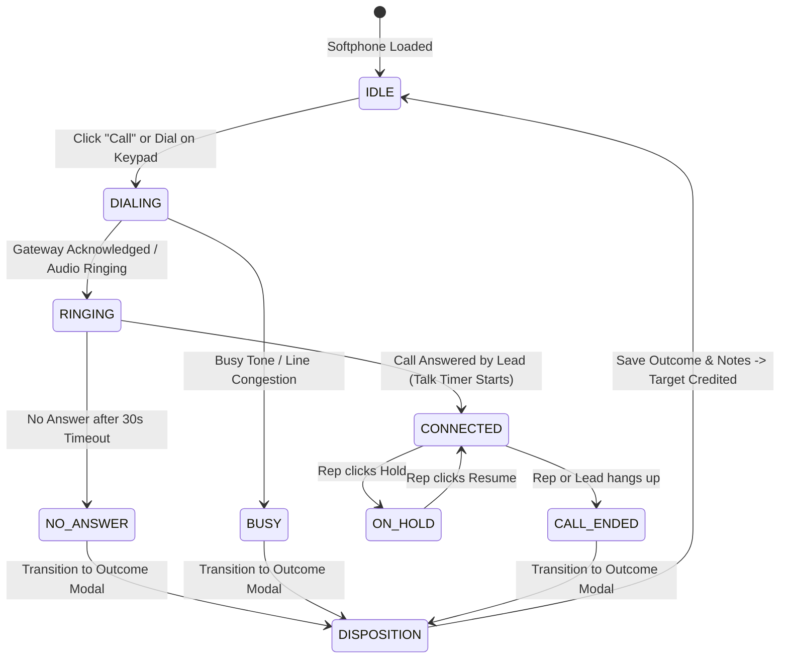

# Skillyards Telecalling Dialer & Softphone Architecture Guide

**Document Version:** 1.0.0  
**Target Application:** `apps/crm`, `apps/api`, `apps/ai-service`, `packages/db`  
**Status:** Approved Architectural Blueprint & Implementation Specification  

---

## 1. Executive Summary

In an enterprise EdTech Admissions CRM like **Skillyards**, telecalling is the primary engine of revenue and student conversion. A Telecalling Dialer enables sales representatives (counsellors and telecallers) to reach registered prospects, qualify candidates, record call outcomes, schedule counselling sessions, and automatically track daily End-of-Day (EOD) targets without manual data entry.

This guide details **everything required** to implement an enterprise telecalling dialer in Skillyards CRM, comparing telephony models, detailing technical prerequisites, defining the live state machine, providing API contracts, and outlining the step-by-step rollout.



---

## 2. Telecalling Models Comparison

Before writing code, choose the right telephony architecture based on telecom regulations (e.g. TRAI compliance in India), budget, and team workflow.

| Feature / Metric | Model A: In-Browser WebRTC Softphone | Model B: Cloud PBX Click-to-Call Bridge | Model C: Android GSM Tracker App |
| :--- | :--- | :--- | :--- |
| **How it Works** | Sales rep wears a USB headset and speaks directly through the browser. Audio is transmitted via WebRTC. | Sales rep clicks "Call". Cloud PBX calls rep's mobile first, then calls lead and bridges them. | Rep dials directly from company Android phone SIM. A background app logs call & syncs audio. |
| **Hardware Needed** | Computer + Headset / Microphone | Any smartphone / feature phone | Android smartphone with SIM card |
| **Telephony Providers** | Twilio Client, Plivo, WebRTC SIP (Asterisk / FreePBX) | Exotel, Knowlarity, Twilio Voice, Tata Tele | Standard telecom SIM (Jio / Airtel unlimited) |
| **Call Recording** | Handled natively by WebRTC media server | Cloud PBX records automatically & triggers webhook | Android accessibility service records audio |
| **Cost** | Per-minute VoIP rates (~$0.01 - $0.02/min) | Per-minute bridge rates (2 legs: rep + lead) | Fixed monthly SIM plan (~₹300 - ₹500/month/rep) |
| **Audio Quality** | Depends on rep's internet connection | Crystal clear GSM mobile carrier network | Direct GSM mobile carrier network |
| **Skillyards Readiness** | **Ideal for Web CRM Softphone Cockpit** | **Supported via Webhook Integration** | **Already partially structured in `docs/CALL_TRACKER_*`** |

> [!TIP]
> **Recommended Hybrid Architecture for Skillyards:**
> 1. **Phase 1 (Interactive In-App Softphone Cockpit):** Build a rich, interactive in-browser dialer widget in `apps/crm` with full audio simulation (ringtone, DTMF tones, live call timer, mute, hold, disposition modal) and optimistic offline fallback.
> 2. **Phase 2 (Cloud PBX Adapter):** Connect the frontend dialer triggers to Cloud PBX adapters (Exotel / Twilio WebRTC / Asterisk SIP) for real-time outbound dialing.
> 3. **Phase 3 (Mobile GSM Ingestion):** Re-unify incoming calls and field SIM logs via the existing Cloudflare R2 / Android tracker pipeline.

---

## 3. Technical Prerequisites & Dependencies

To implement the Telecalling Dialer, the following services and libraries are required:

### 3.1 Frontend Web Application (`apps/crm`)
- **Web Audio API (`AudioContext`):** Generates realistic DTMF dial-pad tones (dual-frequency beeps for 0-9, \*, #) and call progression audio (ringing, busy, call connected chime, call ended tone) without external audio files.
- **MediaStream & Microphone API:** `navigator.mediaDevices.getUserMedia({ audio: true })` for capturing headset audio when live WebRTC is active.
- **WebRTC Client SDK (Optional for real VoIP):** `@twilio/voice-sdk` or `sip.js` or `livekit-client`.
- **Sonner / UI Notifications:** Real-time call toasts (incoming call banner, call dropped alert).

### 3.2 Backend Services (`apps/api`)
- **Cloud Telephony Credentials (for production live calling):**
  - **Exotel (India PSTN standard):** `EXOTEL_API_KEY`, `EXOTEL_API_TOKEN`, `EXOTEL_SUBDOMAIN`, `CALLER_ID` (Virtual Number).
  - OR **Twilio Voice:** `TWILIO_ACCOUNT_SID`, `TWILIO_AUTH_TOKEN`, `TWILIO_TWIML_APP_SID`, `TWILIO_CALLER_ID`.
- **Database (`packages/db`):**
  - PostgreSQL tables: `calls`, `follow_ups`, `call_recordings`, `eod_reports`.
- **Object Storage (`Cloudflare R2` / S3):**
  - Bucket for storing dual-channel MP3/WAV call recordings.
- **AI Audio Pipeline (`apps/ai-service`):**
  - Google Gemini 1.5 Flash API key for automatic transcription, sentiment analysis, and adherence audits.

---

## 4. The Call Lifecycle State Machine

A telecalling softphone must strictly manage call transitions to prevent ghost states, double-dialing, or lost call notes.



### State Definitions & Actions:
1. **`IDLE`**: Dialer is ready. Shows rep status (Available / In Call / Do Not Disturb), speed-dial shortcuts, and recent lead context.
2. **`DIALING`**: Outbound signaling initiated. Play DTMF beeps. Softphone displays candidate name, course interest, and location.
3. **`RINGING`**: Simulated or gateway audio ringback tone. Cancellation button available.
4. **`CONNECTED`**: Voice path established. Call timer starts (`00:00`). Rep controls activated: **Mute**, **Hold**, **Dialpad (DTMF)**, **Transfer**, **End Call**.
5. **`CALL_ENDED`**: Voice path torn down. Duration locked in seconds. Audio stop.
6. **`DISPOSITION` (Mandatory)**: Rep cannot start a new call until selecting a standardized outcome and entering discussion notes.

---

## 5. Standardized Call Outcomes & EOD Attribution

In accordance with **SPEC-6 (`06-sales-operations-detailed.md`)**, call dispositions must be strictly standardized rather than free text:

| Outcome Value | Display Label | Description | EOD Target Effect | Next Action |
| :--- | :--- | :--- | :--- | :--- |
| `connected` | Connected / Spoke | Spoke with candidate; verified course interest. | +1 Dial, +1 Connect, +N Talk-time seconds | Updates Lead status to *Contacted* |
| `counselling_booked` | Counselling Scheduled | Candidate agreed to a career counselling session. | +1 Dial, +1 Connect, +1 Scheduled Credit | Opens Counselling Booking Modal |
| `callback_requested` | Callback Requested | Prospect requested call at a specific later time. | +1 Dial, +1 Connect (if >15s) | Creates Follow-up Task with Due Date/Time |
| `no_answer` | Ringing / No Answer | Phone rang full duration; no answer. | +1 Dial, 0 Connects, 0 Talk-time | Auto-schedules retry queue |
| `busy` | Busy / Line Engaged | User was engaged on another line. | +1 Dial, 0 Connects, 0 Talk-time | Moves to retry queue in 2 hours |
| `invalid_number` | Invalid / Switched Off | Phone number is wrong or permanently unreachable. | +1 Dial, 0 Connects | Flags lead as *Unreachable / Cold* |
| `not_interested` | Not Interested / Drop | Prospect explicitly rejected course offerings. | +1 Dial, +1 Connect | Archives lead with rejection reason |

---

## 6. Frontend Component Architecture (`apps/crm`)

The telecalling experience consists of 3 synchronized UI components:

```text
apps/crm/src/components/telephony/
├── SoftphoneDrawer.jsx         # Docked floating phone widget (collapsible bottom-right)
├── DialerPad.jsx               # Numeric touch keypad (1-9, *, #) with audio DTMF feedback
├── ActiveCallCockpit.jsx       # Live call timer, candidate summary, mute, hold, end buttons
├── CallDispositionModal.jsx    # Post-call outcome tagging, notes, and callback scheduler
└── useTelephony.js             # Global hook managing Web Audio API, call states, timer & API sync
```

### Component Breakdown:
1. **`SoftphoneDrawer`**:
   - Always accessible from any page in the CRM.
   - Sits unobtrusively in bottom-right corner or launches as a slide-over cockpit.
   - Expandable/collapsible with clean cockpit dark aesthetic matching `#0c1316`.
2. **`DialerPad`**:
   - Clean luxury keypad with numbers, letters (like a standard phone: 2=ABC, 3=DEF), and backspace.
   - Uses Web Audio API oscillator synthesis to produce authentic DTMF tones.
3. **`ActiveCallCockpit`**:
   - Shows candidate avatar, full name, phone number, and targeted course (e.g. *Full Stack Development*).
   - High-contrast live timer (`02:45`) in emerald `#2E7559`.
   - Action controls: Mute Microphone, Hold Call, Keypad, Hang Up (Red).
4. **`CallDispositionModal`**:
   - Automatically surfaces immediately upon call termination.
   - Prevents representatives from closing without selecting an outcome.
   - Pre-fills call duration and offers one-click *"Book Counselling"* or *"Set Callback Reminder"*.

---

## 7. Backend Data Model & API Contracts

### 7.1 Database Schema (`packages/db/src/schema/calls.js`)

```javascript
import { pgTable, uuid, text, integer, timestamp, jsonb } from "drizzle-orm/pg-core";
import { users } from "./users";
import { leads } from "./leads";

export const calls = pgTable("calls", {
  id: uuid("id").primaryKey().defaultRandom(),
  leadId: uuid("lead_id").references(() => leads.id, { onDelete: "cascade" }),
  telecallerId: uuid("telecaller_id").references(() => users.id, { onDelete: "cascade" }),
  leadPhone: text("lead_phone").notNull(),
  direction: text("direction").default("outbound"), // "outbound" | "inbound"
  status: text("status").notNull(), // "initiated" | "ringing" | "connected" | "ended" | "failed"
  duration: integer("duration").default(0), // Total talk-time in seconds
  outcome: text("outcome"), // "connected" | "counselling_booked" | "callback_requested" | etc.
  notes: text("notes"),
  recordingUrl: text("recording_url"),
  metadata: jsonb("metadata").default({}), // Provider CallSID, audio format, latency
  startedAt: timestamp("started_at").defaultNow(),
  endedAt: timestamp("ended_at"),
  createdAt: timestamp("created_at").defaultNow(),
});
```

### 7.2 REST API Endpoints

#### 1. Initiate Outbound Call
- **Endpoint:** `POST /api/telephony/dial`
- **Payload:**
  ```json
  {
    "leadId": "lead-101",
    "leadPhone": "+919876543210",
    "telecallerId": "usr-rep-01"
  }
  ```
- **Response (200 OK):**
  ```json
  {
    "callId": "call-992381",
    "status": "ringing",
    "providerRef": "CA_twilio_or_exotel_sid"
  }
  ```

#### 2. Log Call Disposition & Notes
- **Endpoint:** `POST /api/telephony/disposition`
- **Payload:**
  ```json
  {
    "callId": "call-992381",
    "outcome": "callback_requested",
    "duration": 142,
    "notes": "Candidate interested in MERN stack; wants evening callback at 6 PM.",
    "callbackAt": "2026-10-20T18:00:00Z"
  }
  ```
- **Side Effects:**
  1. Updates `calls` table record with duration and outcome.
  2. Updates `leads` table status and last contacted timestamp.
  3. Inserts a task into `follow_ups` with due date `2026-10-20 18:00`.
  4. Appends +1 Dial, +1 Connect, +142s Talk-Time to representative's EOD ledger.

---

## 8. Step-by-Step Implementation Roadmap

```text
┌────────────────────────────────────────────────────────────────────────┐
│ PHASE 1: Interactive Softphone Cockpit UI & Audio Synthesizer (APPS/CRM) │
├────────────────────────────────────────────────────────────────────────┤
│ 1. Build Web Audio API DTMF tone generator (beeps & ringtones)         │
│ 2. Create Floating Softphone Docked Widget (`SoftphoneDrawer.jsx`)    │
│ 3. Build Numeric Keypad with auto-search lead lookup                  │
│ 4. Build Live Active Call Cockpit with running timer, mute & hold      │
│ 5. Build Mandatory Call Disposition & Follow-up creation modal         │
│ 6. Wire 1-Click "Call" buttons on Lead Detail & Queue to Softphone    │
└──────────────────────────────────┬─────────────────────────────────────┘
                                   ▼
┌────────────────────────────────────────────────────────────────────────┐
│ PHASE 2: End-to-End State Sync & EOD Attribution Integration           │
├────────────────────────────────────────────────────────────────────────┤
│ 1. Synchronize completed calls directly with Lead Activity Timeline   │
│ 2. Real-time update to rep's daily EOD Dials and Talk-time counters    │
│ 3. Auto-populate Follow-up Queue if `callback_requested` selected      │
│ 4. LocalStorage demo persistence for offline operational testing       │
└──────────────────────────────────┬─────────────────────────────────────┘
                                   ▼
┌────────────────────────────────────────────────────────────────────────┐
│ PHASE 3: Cloud Telephony Adapter & Gateway Integration                 │
├────────────────────────────────────────────────────────────────────────┤
│ 1. Provider Adapter layer (Exotel / Twilio Voice WebRTC)               │
│ 2. Inbound webhook handlers for live call events and recording URLs   │
│ 3. Auto-dispatch audio recordings to Cloudflare R2                     │
│ 4. Trigger Gemini 1.5 Flash AI transcription & compliance analysis     │
└────────────────────────────────────────────────────────────────────────┘
```

---

## 9. Conclusion & Immediate Next Step

With this blueprint in place, the immediate next step is **Phase 1**:
- Implement the interactive **In-App Softphone & Dialer Cockpit** directly inside `apps/crm`.
- Add the Web Audio DTMF & ringtone synthesis.
- Wire every "Call" icon in the CRM (Leads Directory, Lead Details, Call Queue) to trigger the live dialer cockpit.
- Connect post-call dispositions to automatically credit the representative's EOD target actuals.
